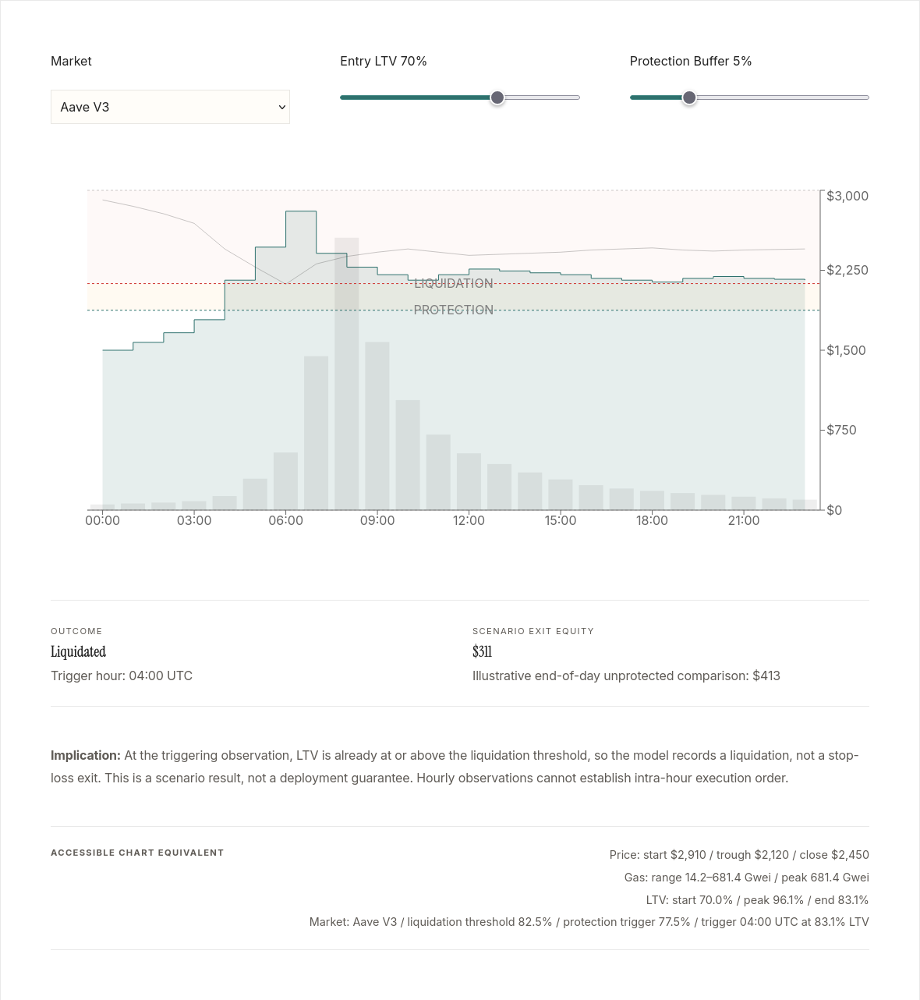

# DeFi risk analysis: a static stop-loss stress test on one day of hourly ETH data



**Live:** [summer-fi-risk-analysis.vercel.app](https://summer-fi-risk-analysis.vercel.app)

This is an independent portfolio case study. A small Python model replays 24 hourly ETH price and gas observations for 5 August 2024 against static stop-loss buffers. It uses illustrative Aave V3 and Morpho parameters. A Next.js page lets a reader change the market, entry LTV and buffer and see the outcome. The repository is not affiliated with Summer.fi, Aave or Morpho.

## Results

All numbers come from `data/aug_5_crash_data.csv` and `reports/sweep_results.csv`.

- **Scenario.** ETH goes from 2,910 at 00:00 to a 2,120 low at 06:00 and closes at 2,450 (-27.1% to the low, -15.8% at the close). Peak gas is 681.4 Gwei at 08:00.
- **Sweep.** 50 static runs: 2 protocols x 5 entry LTVs (0.60 to 0.80) x 5 buffers (2% to 12%).
- **Aave V3 parameters.** 21 runs end in a stop-loss exit and 4 in liquidation.
- **Morpho parameters.** 12 runs end in a stop-loss exit, 6 in liquidation and 7 stay active.
- **Reading the result.** A wider buffer turns a liquidation into a stop-loss exit at the same entry LTV. The sweep shows this only for this one day of data.

## How it works

`scripts/risk_model.py` holds a `DeFiRiskModel`. At each hourly row it computes LTV as `debt / (collateral x price)`. It checks the liquidation threshold first, then the stop-loss trigger (threshold minus buffer). Gas does not change LTV. It adds slippage (`0.1% + gas/100 x 0.5%`, capped at 5%) and a fixed 300,000-gas cost to the modeled exit value. Only a static strategy exists. `web-showcase/src/app/riskModel.ts` mirrors the model for the interactive page. `notebooks/aug5_analysis.ipynb` plots the data and the sweep.

## Run it

Needs Python 3.14 (the version tested; `pandas==3.1.0` needs 3.11 or newer) and, for the showcase, Node 22. No network or keys are needed after install.

```bash
python3 -m venv .venv && . .venv/bin/activate
pip install -r requirements.txt
python -m pytest tests                      # 11 tests passed on 2026-10-24
python scripts/risk_model.py --combined-sweep   # rewrites reports/sweep_results.csv (identical to the committed file)
python scripts/risk_model.py --protocol AaveV3 --ltv 0.70 --buffer 0.05
jupyter nbconvert --to notebook --execute notebooks/aug5_analysis.ipynb --stdout > /dev/null
```

```bash
cd web-showcase
npm ci
npm run lint && npm run build
npm run dev
```

## Repository layout

- `data/`: the 24-row hourly price and gas CSV.
- `scripts/`: the Python risk model and command-line entry point.
- `tests/`: 11 pytest tests of the model.
- `notebooks/`: plots of the data and the sweep.
- `reports/`: the sweep CSV and a written backtest report.
- `web-showcase/`: the Next.js case-study page and docs viewer.

## Documentation

- [`reports/backtest_report_aug5.md`](reports/backtest_report_aug5.md): assumptions, sweep counts and limits.
- [`CONSULTING_REPORT.md`](CONSULTING_REPORT.md): the case-study write-up and recommendation.
- [`PROJECT_OVERSIGHT.md`](PROJECT_OVERSIGHT.md): scope notes for the workstream.

## Sources

The CSV is described as a "supplied scenario". Its source is not recorded in this repository, and I have not checked it against on-chain or exchange data. Treat the prices and gas values as illustrative inputs, not as a market record.

## Scope and limits

- Illustrative heuristic model. It is not a forecast, a valuation, or a liquidation simulator for live markets.
- One day, 24 hourly rows, one collateral asset. Hourly data cannot show whether a stop-loss would have executed before a breach within the hour, so liquidation is checked first.
- Protocol thresholds (0.825 for Aave V3, 0.945 for Morpho) and penalties (5% and 1%) are fixed parameters, not read from the live protocols. Check them before relying on any result.
- The web model is a separate TypeScript port. No test compares it with the Python model.
- The notebook runs, but its output is not committed.
- Not verified: the data source, the parameter values against current protocol configuration, and the pages at `/docs`.

## License

No license file yet.

Part of [Rahil Bhavan's projects](https://github.com/RahilBhavan).
